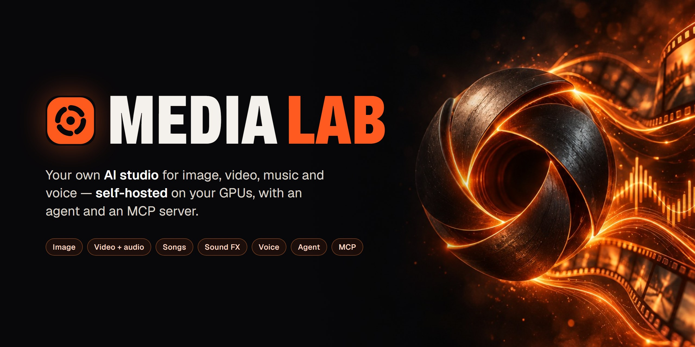
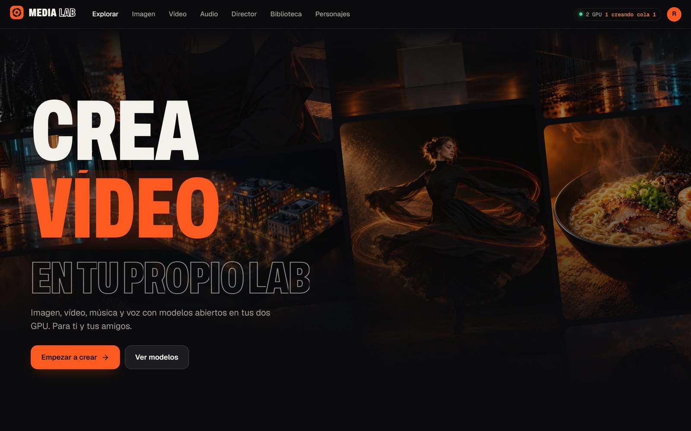
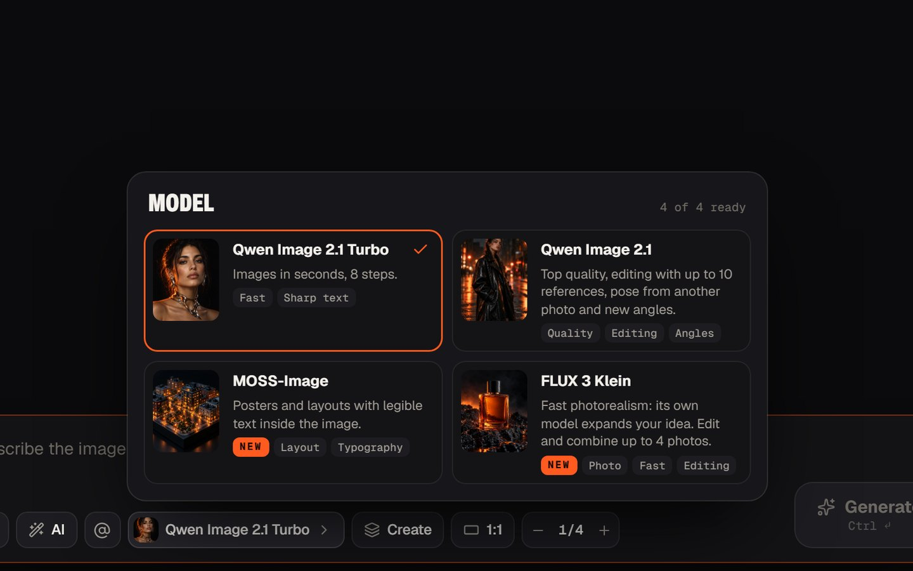
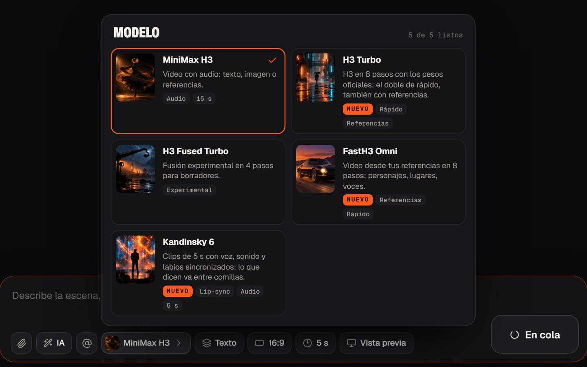
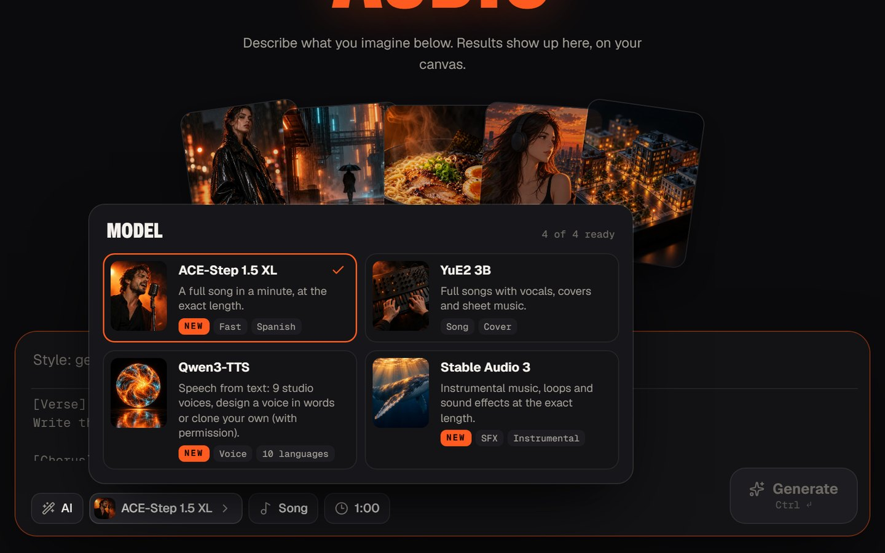
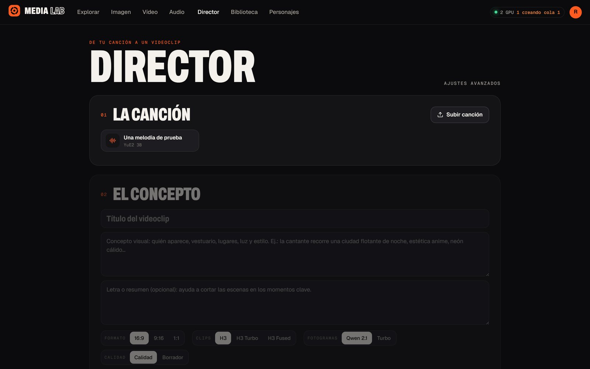
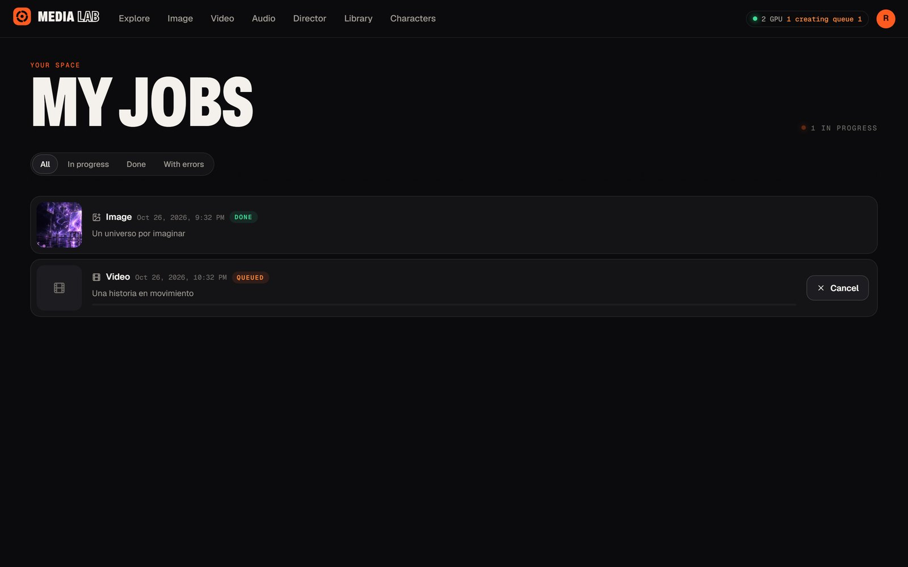
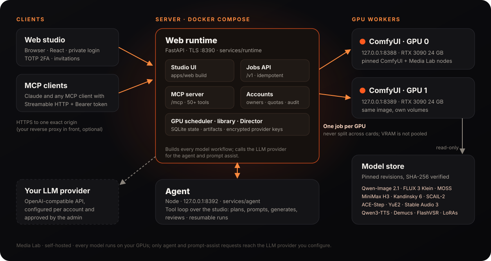

<p align="center">
  
</p>

<p align="center">
  <b>Your own Higgsfield-style creative studio, running on your hardware.</b><br>
  Images, video with sound, songs, sound effects and voices from open models — with an agent and an MCP server.
</p>

<p align="center">
  
  
  
  
  
  
</p>

<p align="center">
  <a href="#what-you-can-make">Features</a> ·
  <a href="#models">Models</a> ·
  <a href="#architecture">Architecture</a> ·
  <a href="#agent-and-mcp-server">Agent & MCP</a> ·
  <a href="#quick-install">Install</a> ·
  <a href="#responsible-use">Responsible use</a> ·
  <a href="#licenses">Licenses</a> ·
  <a href="#en-español">Español</a>
</p>

---

**Media Lab** is a self-hosted studio for generative media. One web app puts today's best open
models behind a single prompt box: photoreal and typographic images, edits with up to ten
references, cinematic video with synchronized audio, full songs, instrumental music and sound
effects, and text-to-speech. Everything runs on your own GPUs through
[ComfyUI](https://github.com/Comfy-Org/ComfyUI) workers; nothing is sent to a cloud
generator. It is built for a small circle — you and your friends — with private accounts,
two-factor login and per-account quotas.

An agent can plan and produce whole requests ("make a 30-second music video from this song"),
and an MCP server exposes the studio to Claude and other MCP clients.

> [!NOTE]
> Media Lab is a personal, non-commercial project. Several of the models it downloads are
> licensed for non-commercial or research use only, and some are gated. Read
> [Licenses](#licenses) before installing.

## What you can make

| | Create | Edit and transform |
|---|---|---|
| **Image** | Text to image with Qwen-Image 2.1 (Base or 8-step Turbo), FLUX 3 Klein photorealism with its own prompt upsampler, MOSS-Image posters with legible text. Nine aspect ratios, optional native 2K. | Edit or compose up to 10 references (FLUX 3 Klein: up to 4), follow the pose, edges or depth of a photo, re-shoot a subject from a new camera angle, remove the background to a transparent PNG. |
| **Video** | MiniMax H3 video **with audio** from text, a first/last frame or image/video/audio references, 5–15 s, in Base, Turbo, Fused Turbo and FastH3 Omni profiles. Kandinsky 6: 5 s clips with speech and **lip-sync**. | Follow another clip's motion, edges or depth; swap a character or just the head (H3 Character Swap, Head Swap, SCAIL-2); refine faces; remove a person; upscale 2× or 4× with FlashVSR. |
| **Music** | Full songs with vocals from style tags and lyrics: ACE-Step 1.5 XL Turbo (exact length, about a minute) or YuE2 3B (up to 15 min, ABC scores). Instrumentals, loops, SFX and one-shots with Stable Audio 3. | Covers from a song's melody (YuE2), stem separation into vocals + instrumental or four stems (Hybrid Demucs). |
| **Voice** | Qwen3-TTS in 10 languages: nine studio voices with delivery instructions, or a new voice designed from a description. | Clone a voice from a 3–30 s clip — **only with the speaker's permission**; the API refuses without explicit consent. |
| **Productions** | The **Director** turns a song into a music video: audio analysis, an editable storyboard, keyframes and clips per scene, MP4 preview and a master that keeps the original audio stream. | Reuse your own images and clips per scene; resume interrupted productions. |

Plus: a persistent **library** of everything you make, private **characters** you can call with
`@name` in any prompt, a per-account **LoRA library** (paste a Hugging Face or Civitai link;
Qwen-Image 2.1 and MiniMax H3 LoRAs are detected and verified), live job progress, and
invitation-only accounts with TOTP.

## Gallery

<p align="center">
  
</p>

<table>
  <tr>
    <td width="33%"><br><sub><b>Image</b> — Qwen-Image 2.1, Turbo, MOSS-Image, FLUX 3 Klein</sub></td>
    <td width="33%"><br><sub><b>Video</b> — MiniMax H3 profiles and Kandinsky 6</sub></td>
    <td width="33%"><br><sub><b>Audio</b> — ACE-Step, YuE2, Qwen3-TTS, Stable Audio 3</sub></td>
  </tr>
  <tr>
    <td colspan="2"><br><sub><b>Director</b> — from a song to a music video</sub></td>
    <td><br><sub><b>Jobs</b> — live queue across both GPUs</sub></td>
  </tr>
</table>

<sub>Screenshots of the real interface with demo data. The studio UI is in Spanish; the API, agent
guides and MCP server are in English.</sub>

## Models

Each model belongs to an **install group** of [`deploy/install.sh`](deploy/install.sh). Every file
is downloaded at a pinned revision and verified by SHA-256 by the scripts in
[`deploy/scripts/`](deploy/scripts). Sizes are approximate downloads.

| Model | Used for | Group | Size | License |
|---|---|---|---|---|
| [Qwen-Image 2.1](https://huggingface.co/Qwen/Qwen-Image-2.1) + Turbo (Comfy-Org INT8) | Image, edit, background removal, Director keyframes | `qwen` (required) | ~44 GB | Qwen Research License — **non-commercial** |
| Qwen-Image 2.1 BF16 | Higher-precision image weights | `qwen-bf16` | ~14 GB | Qwen Research License — **non-commercial** |
| Qwen 2.1 Fun ControlNet Union, QMA camera angles, Depth Anything 3, SDPose | Structure control, camera angles | `qwen-control` | ~8 GB | Qwen Research; Apache-2.0; MIT |
| [MOSS-Image](https://huggingface.co/Comfy-Org/MOSS-Image) SFT | Posters, layouts, in-image text | `moss` | ~13 GB | Apache-2.0 |
| [FLUX 3 Image Klein](https://huggingface.co/black-forest-labs/flux-3-image-klein-comfy) | Fast photorealism and editing | `flux3` | ~24 GB | FLUX Kommunity License — **gated** |
| [MiniMax H3](https://huggingface.co/MiniMaxAI/MiniMax-H3) (FL2VA, Ref2VA) + Fused Turbo merge | Video with audio | `h3` | ~84 GB | MiniMax H3 Community License; Fused Turbo: research use |
| LightX2V H3 Turbo LoRAs | 8-step H3 profile | `h3-turbo` | ~4 GB | MiniMax H3 Community License |
| FastH3 Omni | 8-step reference video | `h3-omni` | ~22 GB | MiniMax H3 Community License |
| H3 Fun ControlNet-Union 2.0, RT-DETR | Follow a video's motion, edges or depth | `h3-control` | ~5 GB | MiniMax H3 Community License; see upstream |
| H3 Character Swap v1.5, Head Swap, Person Remover, SAM 3.1, MediaPipe | Swaps, face refine, person removal | `video-edit` | ~5 GB | MiniMax H3 Community License; Meta SAM License; Apache-2.0; see upstream |
| [SCAIL-2](https://huggingface.co/Comfy-Org/SCAIL-2) | Character replacement with tight body motion | `scail2` | ~27 GB | MIT; Wan 2.1 encoder and VAE Apache-2.0; LoRA and CLIP vision: see upstream |
| [Kandinsky 6.0 Lite](https://github.com/kandinskylab/kandinsky-6) + MMAudio VAE + BigVGAN | 5 s video with speech and lip-sync | `kandinsky6` | ~18 GB | MIT; Qwen2.5-VL Apache-2.0; MMAudio VAE CC-BY-NC-4.0 — **non-commercial** |
| [YuE2 3B](https://huggingface.co/m-a-p/YuE2-3B) + SheetSage2 | Songs, ABC scores, covers | `yue2` | ~5 GB | See the model card |
| [ACE-Step 1.5 XL Turbo](https://huggingface.co/Comfy-Org/ACE-Step-1.5) | Full songs of exact length | `ace-step` | ~20 GB | Apache-2.0 |
| [Stable Audio 3](https://huggingface.co/Comfy-Org/stable-audio-3) Medium + Small SFX | Instrumentals, loops, SFX, one-shots | `stable-audio3` | ~18 GB | Stability AI Community License |
| [Qwen3-TTS](https://huggingface.co/Qwen/Qwen3-TTS-12Hz-1.7B-Base) 12 Hz 1.7B (Base, CustomVoice, VoiceDesign) | Speech, designed voices, consented cloning | `tts` | ~14 GB | Apache-2.0 |
| Hybrid Demucs | Stem separation | `stems` | <1 GB | MIT |
| [FlashVSR v1.1](https://huggingface.co/JunhaoZhuang/FlashVSR-v1.1) | Video upscaling (part of `qwen`) | `qwen` | — | Apache-2.0 (node GPL-3.0) |

Presets: **minimal** = `qwen` (~44 GB) · **recommended** = Qwen, structure control, MOSS,
FLUX 3 Klein, H3 + Turbo, ACE-Step, Stable Audio 3, Qwen3-TTS and stems (~230 GB) · **all**
(~326 GB). `deploy/install.sh list-models` prints the current table.

> [!NOTE]
> Kandinsky 6 and SCAIL-2 also read encoders from the shared model directory
> (`~/media-lab-data/models/shared` by default): the Qwen2.5-VL 7B text encoder, and the Wan 2.1
> UMT5-XXL text encoder and VAE. Their groups fetch them with
> `deploy/scripts/download-shared-comfy-models.sh` (Comfy-Org repackages, pinned and
> SHA-256-verified) and skip files that are already there and verified.

The studio only offers what is installed: `GET /v1/capabilities` (and the MCP `capabilities`
tool) reports each model's readiness from the files on disk.

## Architecture

<p align="center">
  
</p>

| Component | Path | Role |
|---|---|---|
| Web studio | [`apps/web`](apps/web) | React + Vite single-page app: creator, Explore, Library, Jobs, Director, Characters, account and admin pages. |
| Runtime | [`services/runtime`](services/runtime) | FastAPI web/API server over TLS: accounts (Argon2id, TOTP, invitations), per-owner storage and SQLite state, job admission and the GPU scheduler, workflow builders for every model, the MCP server and the web build. |
| Agent | [`services/agent`](services/agent) | Private Node service (loopback only) running the tool loop: it reads the model guides, writes model-ready prompts, submits jobs, inspects results and keeps resumable runs. Provider calls and secrets are handled by the runtime. |
| GPU workers | [`deploy/Dockerfile.comfyui`](deploy/Dockerfile.comfyui) | Two ComfyUI instances, one per GPU, from a pinned ComfyUI commit and pinned custom-node packs, plus Media Lab's own nodes in [`services/comfyui-nodes`](services/comfyui-nodes) (stems, speech). |
| Deployment | [`deploy/`](deploy) | `compose.yml` + `compose.web.yml`, Dockerfiles, model download scripts and the installer. |

**One job per GPU.** The two cards are independent workers, not pooled VRAM: a job never spans
both GPUs, and the scheduler sends each new job to the free (or least busy) worker. Models are
unloaded after a short idle period so the cards can be shared with other workloads.

## Agent and MCP server

### The agent

Turn on **IA** in the creator, or open the agent, and describe the result you want. The agent
uses an **OpenAI-compatible chat API that you configure per account** (any provider with tool
calling; vision is optional and verified). The administrator approves which HTTPS endpoints
may be used; keys are stored encrypted (AES-256-GCM) and the runtime makes the provider calls on
the agent's behalf. Generation itself always happens on your GPUs.

It works with the same tools as the studio: image generation and editing, video, music, sound,
speech, upscaling, swaps, face refine, stems, the Director, the library and your characters.
It checks prompts before spending GPU time, never retries a failed generation on its own, and
asks before resuming work or cloning a voice.

### The MCP server

Every account can expose its own studio to MCP clients at `https://<your-origin>/mcp`
(Streamable HTTP, personal Bearer tokens):

1. In the web app open **Cuenta → Conexiones MCP**, enable MCP and create a token with an
   expiry and scopes: `read` (required), `create`, `agent`, `delete`.
2. Copy the token once — only its SHA-256 digest is stored.
3. Add the server to your client. With Claude Code:

   ```bash
   claude mcp add --transport http media-lab https://media.example.com/mcp --header "Authorization: Bearer <token>"
   ```

   Other clients need Streamable HTTP with a custom `Authorization` header; the web page also
   offers a ready `mcpServers` configuration and copyable agent instructions.

The server ships **55 tools**, English instructions, per-model prompt guides
(`prompt_guide`, `media-lab://guides/*` resources) and prompt templates:

| Area | Tools |
|---|---|
| Discover | `capabilities`, `studio_status`, `account_profile`, `account_preferences`, `prompt_guide`, `check_prompt` |
| Create | `generate_image`, `edit_image`, `generate_video`, `generate_music`, `generate_sound`, `generate_speech`, `create_production` |
| Transform | `upscale_video`, `swap_character`, `refine_faces`, `remove_person`, `separate_stems` |
| Jobs | `list_jobs`, `get_job`, `wait_for_job` (progress notifications), `get_job_preview`, `find_job`, `cancel_job`, `resume_job` |
| Files | `create_uploads`, `get_uploads`, `get_download_links`, `get_media`, `inspect_media`, `analyze_audio`, `review_image`, `export_image`, `upload_reference`, `upload_audio`, `upload_video` |
| Library | `list_library`, `list_gallery`, `list_characters`, `list_loras`, `delete_media` |
| Agent | `start_agent`, `get_agent_run`, `list_agent_runs`, `cancel_agent`, `continue_agent`, `improve_prompt`, `review_with_agent`, `plan_storyboard` |
| Conversations & providers | `list_sessions`, `get_session`, `add_message`, `provider_status`, `list_providers`, `discover_models` |

Files move with short-lived upload and download links (`curl -T` / `curl -o`), so agents never
paste megabytes of base64. Tokens are scoped to their owner, rate-limited and revocable. The
complete guide is [`docs/MCP-GUIDE.md`](docs/MCP-GUIDE.md); the server design and token
lifecycle are in [`docs/MCP.md`](docs/MCP.md); every model control is in
[`docs/MODEL-CONTROLS.md`](docs/MODEL-CONTROLS.md).

## Requirements

| | Tested | Notes |
|---|---|---|
| GPUs | **2× NVIDIA RTX 3090 24 GB** | One ComfyUI worker per GPU. 24 GB per card is the tested size; one GPU can be tried with `--single-gpu` (untested). |
| Driver | NVIDIA 595 | CUDA 13 (driver 580 or newer): the ComfyUI image starts from `pytorch/pytorch:2.12.1-cuda13.0-cudnn9-devel`. |
| OS | Ubuntu Linux | Any Linux with Docker Engine, Docker Compose **2.24.4+** and the NVIDIA Container Toolkit. |
| Disk | ~370 GB free | ~44–326 GB for models depending on the groups, ~40 GB for images, plus your library. |
| Network | — | A host name for the HTTPS origin; a reverse proxy with a public certificate is recommended. |
| Accounts | — | A Hugging Face account and read token for gated models (FLUX 3 Klein). |

Rough timings on one RTX 3090 from the 0.13.0 validation: Turbo/MOSS image 25–35 s, ACE-Step
30 s song 25 s, stem separation 5 s, H3 Turbo text-to-video 80 s, character swap at 480p 6–8 min.

## Quick install

```bash
git clone https://github.com/Xainner/media-lab.git
cd media-lab

# Only for gated models such as FLUX 3 Klein: accept the licence on its Hugging Face page,
# then save a read token in the standard location (~/.cache/huggingface/token).
hf auth login

deploy/install.sh --origin https://media.example.com --models recommended
```

The installer:

1. **Checks the host** — Linux, Docker and Compose versions, NVIDIA Container Toolkit, GPUs,
   VRAM and driver, free disk for the selected models and images, free ports, and the Hugging
   Face token (validated against Hugging Face, never printed or stored elsewhere).
2. **Saves your settings** in `~/media-lab-data/media-lab.conf` (no secrets) and prepares the model,
   state and LoRA directories.
3. **Creates the private keys** (`master.key`, `agent.key`) and a private origin CA and TLS
   certificate for your host name in `~/media-lab-data/secrets` (mode 0700). Existing keys are never
   replaced.
4. **Downloads the models** you chose with the pinned scripts. Interrupted downloads resume;
   verified files are skipped.
5. **Writes a Compose override** for your paths and origin, builds the ComfyUI, web and agent
   images and starts `deploy/compose.yml` + `deploy/compose.web.yml`.
6. **Prints a one-time link** (valid 30 minutes) to create the first administrator. Invite
   everyone else from the admin pages.

Re-running it is safe at any point. Preview everything first with `--dry-run`, and see every
option with `deploy/install.sh --help`. Installing with an AI coding agent? Point it at
[`AGENTS.md`](AGENTS.md): it covers tokens, licences and the steps that stay with you.

## Configuration

**Origin and TLS.** Media Lab answers on exactly one HTTPS origin (`--origin`), checks the Host
header and uses Secure cookies. The web runtime listens with TLS on port 8390 using the private
origin certificate:

- **Behind a reverse proxy (recommended).** Keep `--listen 127.0.0.1` (default). Proxy your
  public name to `https://127.0.0.1:8390`, keep the `Host` header, verify the upstream with
  `~/media-lab-data/secrets/origin-ca.crt` (server name = your host name), allow 501 MB request bodies
  and 600 s timeouts, and disable buffering.
  [`deploy/npm-proxy-advanced.conf`](deploy/npm-proxy-advanced.conf) is a working Nginx
  Proxy Manager example.
- **Direct on the LAN.** Use `--listen 0.0.0.0` and an origin with the port, such as
  `https://medialab.lan:8390`, make the name resolve to the server, trust `origin-ca.crt` on
  your devices and firewall port 8390.

| Setting | Option | Default |
|---|---|---|
| Installation directory | `--home` | `~/media-lab-data` |
| Models / shared models / H3 Fused / LoRAs | `--models-dir`, `--shared-models-dir`, `--h3-fused-dir`, `--loras-dir` | under `~/media-lab-data` |
| Model groups (added to the installed ones) | `--models` | `recommended` |
| Native 2K image creation | `--enable-2k` | off |
| Hugging Face token file | `--hf-token-file` | `~/.cache/huggingface/token` |

**One installation per host.** The Compose project and container names are fixed, so the
installer refuses to run next to a Media Lab stack it did not create.

Optional: put a Civitai API token in `~/media-lab-data/secrets/civitai.token` (mode 600) to add
LoRAs from Civitai links. Mail (invitations, password resets) and LLM providers are configured
in the admin pages.

## Operate, update and roll back

```bash
deploy/install.sh status            # containers and health
deploy/install.sh logs              # web runtime and agent logs
deploy/install.sh stop              # refuses while jobs or agent runs are active (--force to override)
deploy/install.sh start
deploy/install.sh models --models kandinsky6,yue2   # add model groups later
```

**Update.** `deploy/install.sh update` waits until the studio is idle, makes an online backup of
the database to `~/media-lab-data/state/backups/<date>/`, tags the current images as `:rollback`,
runs `git pull --ff-only` and re-runs the installer with your saved settings (`--skip-models`
skips re-verifying every model file).

**Roll back.** `deploy/install.sh rollback` checks out the previous commit, restores the
`:rollback` images and restarts. Add `--restore-db` to also restore the database saved by the
update (work created after the update then disappears from the library). When a release's notes
say its database changes are additive (as in 0.13.0), the code-only rollback is enough.

**Certificate.** The origin certificate lasts one year; `deploy/install.sh renew-cert` reissues it
when it has less than 30 days left and reloads only the idle web runtime.

## Responsible use

Media Lab can produce convincing faces, voices and video. Use it honestly:

- **Clone a voice only with the speaker's permission.** Voice cloning requires an explicit
  consent flag in the API and in the agent, which asks you to confirm it. Clone your own voice or
  the voice of someone who agreed.
- **Swap faces, heads or characters only with consenting people or fictional characters.**
  LoRAs that Civitai marks as depicting a real person are rejected.
- **No deceptive fakes.** Do not create content that impersonates real people, fabricates events
  or is meant to mislead, harass or defraud — and label synthetic media when you share it.
- Follow each model's licence and acceptable-use policy, and the law where you live.

## Licenses

**Model weights are not part of this repository.** The installer downloads them from their
publishers, and **you** are responsible for reading and accepting each licence before using them:

- **Non-commercial or research-only:** Qwen-Image 2.1 and its ControlNet (Qwen Research License),
  the MMAudio VAE used by Kandinsky 6 (CC-BY-NC-4.0) and the community H3 Fused Turbo merge
  (research use).
- **Gated:** FLUX 3 Image Klein (FLUX Kommunity License) — accept it on Hugging Face with the
  account whose token the installer uses.
- **Own community licences:** MiniMax H3 and every H3 LoRA (MiniMax H3 Community License), Stable
  Audio 3 (Stability AI Community License), SAM 3.1 (Meta SAM License), YuE2 (see its card).
- **Permissive:** MOSS-Image, ACE-Step 1.5, Qwen3-TTS, Depth Anything 3, MediaPipe, FlashVSR
  (Apache-2.0); Kandinsky 6, SCAIL-2, SDPose, BigVGAN, Demucs (MIT).
- Some LoRAs and encoders (Head Swap, Taomate, LightX2V Wan, RT-DETR, Wan 2.1 CLIP vision) have
  no licence stated here: check their upstream pages.

Third-party code: ComfyUI and the custom-node packs are cloned at pinned commits into the
ComfyUI image (FlashVSR's node is GPL-3.0); the web UI bundles Animate UI (MIT + Commons Clause),
shadcn/ui (MIT) and OFL fonts — texts in [`apps/web/public/licenses`](apps/web/public/licenses).
No Maestro or WanGP code is used. Details in [`NOTICE.md`](NOTICE.md).

**This repository's own code** is licensed under the [GNU AGPL-3.0](LICENSE): you can use,
modify and self-host it; if you offer a modified Media Lab to other people over a network, you
must share your changes under the same licence. The vendored Animate UI components keep their own
MIT + Commons Clause licence (see [`NOTICE.md`](NOTICE.md)). Generated media is for personal,
non-commercial use under the licences of the models that made it.

## Development

```bash
cd apps/web && npm ci && npm test && npm run build        # web studio
cd services/agent && npm test                              # agent
cd services/runtime && python -m venv .venv && .venv/bin/pip install -e ".[dev]" && .venv/bin/pytest
```

`apps/web/scripts/dev-qa.cjs` serves the UI against disposable fixtures (no GPUs, no
credentials). Release notes and validation records live in [`docs/`](docs)
([0.13.0](docs/RELEASE-0.13.0.md), [0.12.0](docs/RELEASE-0.12.0.md), …); the reference host's
manual reinstall guide is [`docs/REINSTALL.md`](docs/REINSTALL.md).

## En español

**Media Lab** es un estudio creativo autoalojado: imágenes, vídeo con audio, canciones, música
instrumental, efectos y voz con modelos abiertos que corren en tus GPUs, con agente y servidor
MCP. Está pensado para uso personal y no comercial (tú y tus amigos), con cuentas privadas por
invitación y 2FA. La interfaz está en español.

Instalación rápida en un servidor Linux con Docker, NVIDIA Container Toolkit y dos GPUs de 24 GB
(probado con 2× RTX 3090; cada trabajo usa una sola GPU):

```bash
git clone https://github.com/Xainner/media-lab.git && cd media-lab
hf auth login   # solo para modelos con acceso restringido, como FLUX 3 Klein
deploy/install.sh --origin https://media.example.com --models recommended
```

El instalador comprueba el equipo, descarga los modelos elegidos con hashes verificados, crea
las claves y el certificado de origen, construye las imágenes, arranca el stack y te da un enlace
de un solo uso para crear al administrador. Usa `--dry-run` para ver qué haría y `--help` para
todas las opciones. Antes de instalar, **lee y acepta las licencias de cada modelo**: varias son
no comerciales y FLUX 3 Klein exige aceptarla en Hugging Face. Clona voces y cambia caras solo
con el consentimiento de las personas, y nunca para engañar.
